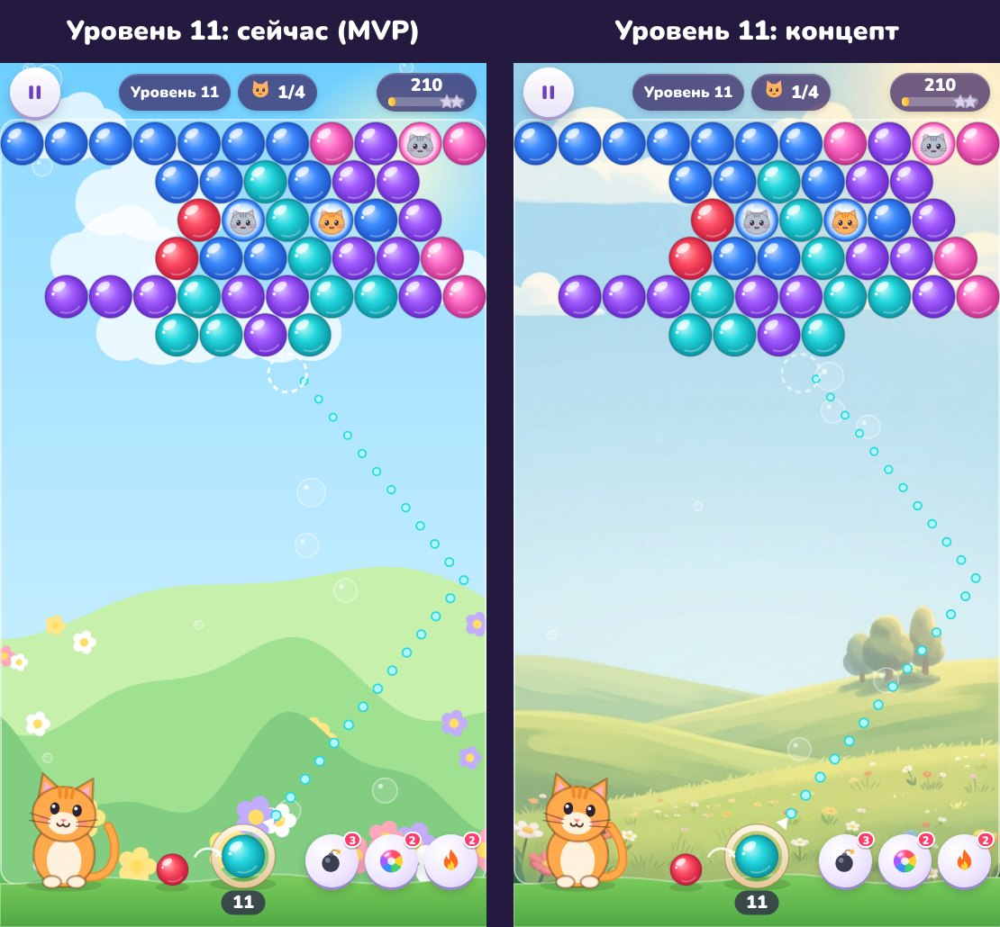
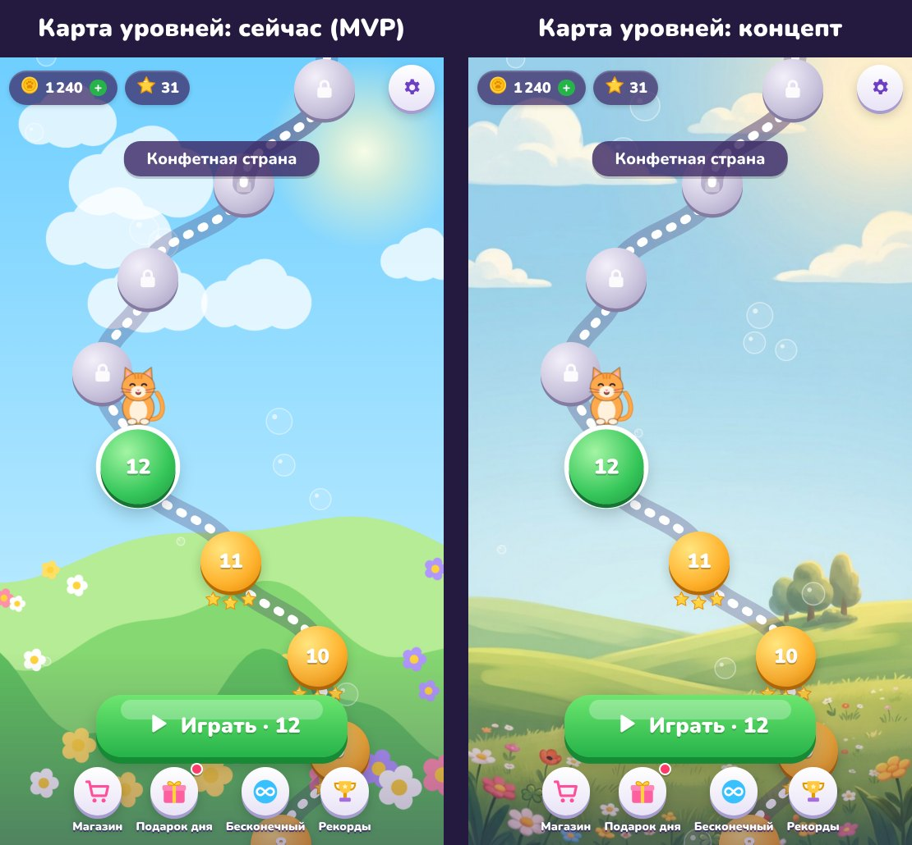

# План: от MVP к коммерческому продукту

Документ основан на коде игры, аудите [`yandex-audit.md`](yandex-audit.md), концепте фона ниже и скиллах из [`skills/`](../skills/README.md).
Цель — поднять показатели, от которых на Яндекс Играх зависят показы в каталоге и доход:

| Рычаг | Что на него влияет | Где в плане |
|---|---|---|
| CTR в каталоге | иконка, обложка, первые скриншоты и видео | Фаза 1 + перегенерация промо |
| Удержание D1/D7 и время в игре (факторы ранжирования) | первое впечатление, «сочность», цели на завтра | Фазы 1–3 |
| Оценка игры (фактор ранжирования) | приятный опыт + просьба оценить в удачный момент | Быстрые победы |
| Доход с рекламы | число добровольных просмотров видео на игрока, аккуратные межуровневые показы | Фаза 4 |
| Доход с покупок | ценные предложения в нужный момент | Фаза 4 |

## 1. Честная оценка: почему сейчас «MVP»

**Что уже на коммерческом уровне** (менять не нужно):
- Ядро: физика отскоков, прицел, 1000 сбалансированных уровней (проверены симуляцией).
- Интеграция SDK, реклама, покупки и сохранения (см. аудит).
- Промоматериалы: ключевой арт, обложки, скриншоты, видео.
- Производительность: soak-тест чистый, архив 140 КБ.

**Что выдаёт MVP:**
1. **Разнобой стилей.** Ключевой арт — рисованная сказочная иллюстрация, а внутри игры всё векторное и процедурное. Игрок видит в каталоге одно, а в игре другое. Это бьёт по удержанию первой минуты.
2. **Плоский интерфейс.** Фиолетовые «пилюли» и простые круглые кнопки без фактуры, обводки и глубины. У топовых казуалок интерфейс «конфетный»: объём, блик, тень, ленты-заголовки, сияние за наградами.
3. **Персонажи.**
   - Котик и котята в шариках нарисованы кодом и выглядят как эмодзи.
   - Нет эмоций и реакции на игру: радости при комбо, грусти при промахе, ожидания.
4. **Карта — дорожка с кругами поверх фона.** Нет декора вдоль пути (деревья, домики, тематические предметы миров), «ворот» между мирами и ощущения путешествия.
5. **Мало «сочности».**
   - Шарики лопаются и падают без продолжения: нет корзинок с очками внизу, полёта монет к счётчику, нарастающего звука комбо, шкалы «азарта».
   - Звуки синтезированы и однообразны.
6. **Нет цели на завтра, кроме ежедневного подарка.** Нет заданий дня, сундуков за звёзды и коллекции котят, а значит — меньше причин вернуться.
7. **Уровни — «случайные кляксы».** Пазлы в форме сердечка, мордочки или цветка выглядят «сделанными руками», а случайные кляксы — нет.

## 2. Концепт: рисованный фон (проверено в игре, без изменения кода)

Фон «Луг» сгенерирован в стиле выбранного ключевого арта и подставлен в игру через тестовый стенд (`tools/concept-preview.mjs`):

| Уровень 11 | Карта |
|---|---|
|  |  |

**Выводы:**
- Фон добавляет глубину и «сказочность»: дальние деревья, цветы, мягкий свет. Особенно заметно на карте.
- **Одного фона мало.** Рядом с рисованным лугом плоские пилюли интерфейса и векторный кот выделяются ещё сильнее. Эффект «как у топов» появится, только когда в одном стиле будут фон, котики и интерфейс (Фаза 1 целиком).
- Нужна доводка:
  - рисованное небо бледнее процедурного — поднять насыщенность и контраст;
  - полупрозрачную подложку поля сделать чуть плотнее для читаемости шариков;
  - для компьютера нужны отдельные горизонтальные фоны: вертикальная картинка при растягивании на 16:9 размоется (~2,5× увеличение).
- Размер: фон 768×1376 в JPEG — 79 КБ (в WebP будет ~50–60 КБ). Восемь миров × 2 ориентации ≈ 1–1,5 МБ, при ленивой загрузке миров это не замедлит старт.

## 3. Быстрые победы (≤ 1 дня, максимальная отдача)

1. **Просьба оценить игру** (`ysdk.feedback.canReview()` → `requestReview()`): один раз, после удачного момента (победа на 3 звезды на 6–10-м уровне), а не на старте. Оценка — фактор ранжирования.
2. **Ярлык на рабочий стол** (`ysdk.shortcut.canShowPrompt()` → `showPrompt()`): предложить после 2-й сессии или на карте после победы. Прямо влияет на возвраты с компьютера.
3. **«Бесплатные монеты» в магазине:** видео за 25–40 монет, до 5 раз в день. Добровольный просмотр — самый доходный и безопасный рекламный формат.
4. **Удаленные настройки через `ysdk.getFlags()`:** частота межуровневой рекламы (60/75/90 с), первый уровень с рекламой, размеры наград. Значения меняются в консоли без новой версии и проверяются A/B-тестом.
5. **Исправления аудита** М1, М2, Н1–Н4 — после вашего подтверждения (скилл Auto Fixer).

> Названия методов сверены с типами SDK (`@types/ysdk` 1.2.0). Перед релизом поведение нужно проверить на черновике с `?debug-mode=16`.

## 4. Фазы

Для каждой фазы действует общий цикл приёмки (скилл `iterate-until-verified`):
1. Правка.
2. `npm run build`.
3. Автотесты: `npm test`, `npm run test:flow`, `npm run test:soak`.
4. Скриншоты всех затронутых экранов в портрете и ландшафте.
5. Проверка, что первая загрузка остаётся маленькой.
6. Перегенерация промо, если изменился вид игры.

### Фаза 1. Единый рисованный стиль (первое впечатление) — 2–3 дня
Ресурсы — по скиллу `build-hybrid-game-assets`: сгенерированные 2D-картинки используются как готовые ресурсы, промпты и источники фиксируются в `promo/src/PROVENANCE.md`.

| Что | Как | Критерий готовности |
|---|---|---|
| Фоны 8 миров | генерация по ключевому арту, вертикальные 9:16 + горизонтальные 16:9, WebP | все 8 миров в обеих ориентациях без размытия; поле читается |
| Маскот | рисованный кот: ожидание / прицел / радость / грусть. Генерация на зелёном фоне → вырезание → PNG с прозрачностью → WebP | эмоции реагируют на игру; анимация «дыхания» и моргания |
| Котята в шариках | 6–8 рисованных мордочек в стиле арта вместо иконок-эмодзи | узнаваемы на размере шарика на телефоне |
| Интерфейс | «конфетная» тема в CSS: объём, блик, обводка, многослойные тени (скиллы `refactoring-ui`, `beautiful-shadows`); заголовки окон — ленты; сияние за наградами | одинаковый стиль на всех экранах; кнопки ≥ 44 px; анимации 120–320 мс (`animation-systems`) |
| Экран загрузки | ключевой арт + полоса прогресса + название на языке игрока | нет текста на чужом языке (закрывает М2) |
| Карта | декор вдоль дорожки по мирам, «ворота» между мирами, плывущие облака | у каждого мира свои декорации; прокрутка плавная |

Технически:
- Ресурсы мира грузятся лениво: в стартовой загрузке только «Луг» и интерфейс, остальное подгружается после `LoadingAPI.ready()`.
- В `tools/build.mjs` добавить копирование `assets/` и проверку латинских имён файлов.

### Фаза 2. «Сочность» — 1–2 дня
По скиллам `create-game-vfx` и `build-game-audio-feedback`:
- Падающие шарики отскакивают в корзинки с очками внизу поля (+очки всплывают цифрами).
- Монеты после победы летят к счётчику, звёзды загораются по очереди со вспышкой.
- Комбо: нарастающая высота звука, шкала «азарта» — после N комбо подряд выдаётся огненный шарик.
- Звук:
  - новый набор эффектов, музыка своя для каждого мира;
  - лимит одновременных голосов, плавные переходы музыки;
  - отдельные переключатели остаются.
- Учитывать `prefers-reduced-motion` и режим `lowFx` (закрывает Н3).
- Критерии готовности:
  - частицы берутся из пула и ограничены по числу;
  - soak-тест без роста памяти;
  - на слабом устройстве (`lowFx`) без падения кадров.

### Фаза 3. Удержание — 2–3 дня
- **Задания дня** (3 в день: «лопни 150 шариков», «пройди 3 уровня», «используй бустер»). Награда — монеты, за все три — сундук.
- **Сундуки за звёзды:** шкала на карте; каждые 20 звёзд — сундук с монетами и бустерами.
- **Коллекция котят («Котодом»):**
  - спасённые котята открывают карточки: 8 миров × 6 котят;
  - собранный мир даёт награду.

  Это долгая цель и прямое продолжение темы игры.
- Расширить ежедневный подарок, оставив фиксированную лестницу без случайности (безопасно для модерации).
- Критерии готовности:
  - все счётчики сохраняются в облаке и укладываются в лимиты `setData`;
  - смена дня по серверному времени;
  - для каждой механики есть тест в `test:flow`.

### Фаза 4. Монетизация — 1–2 дня
- **Новые места для видео за награду** (всё добровольно, на кнопке написано «за просмотр рекламы» и сама награда):
  - удвоить сундук;
  - бустер перед уровнем;
  - «бесплатные монеты» в магазине;
  - дополнительная попытка в задании дня.
- **Стартовый набор** (разовая покупка со скидкой): монеты + бустеры. Предлагать после 5–8-го уровня, когда игрок уже вовлечён.
- **Копилка:** монеты копятся за игру; разбить можно покупкой. Это хорошо конвертирующая механика казуальных игр. Описание покупки должно быть честным и полным.
- Межуровневая реклама остаётся в паузах. Частоту подбираем через `getFlags()` и A/B-тест, смотрим на удержание, а не только на показы.
- **Вне игры:**
  - новые покупки добавить в `promo/iap/purchases.csv` и консоль (вкладка «Инап-покупки»), список в игре должен совпадать;
  - платные «колёса удачи» и лутбоксы не делаем.

### Фаза 5. Контент — 2+ дня
- **Фигурные уровни:** шаблоны (сердце, мордочка, цветок, рыбка, снежинка…) с зеркальной симметрией в генераторе. Баланс — через `npm run simulate`.
- **Новая механика в каждом мире:** лёд (2 попадания), шарик-хамелеон, облака-блоки, клетки с котятами. Каждая вводится обучалкой.
- **Босс в конце мира** (каждые 15 уровней) — запоминающееся событие.

## 5. Ограничения и бюджеты
- **Первая загрузка:** цель ≤ 2 МБ до `LoadingAPI.ready()` (сейчас 140 КБ). Весь архив — ≤ 10 МБ (лимит платформы 100 МБ).
- **Изображения:** WebP/JPEG; PNG — только для прозрачности. Имена файлов латиницей.
- **Модерация:** каждую фазу перед отправкой прогонять через скилл аудитора (`docs/yandex-audit.md` обновляется).
- **Промо:** после фаз 1–2 перегенерировать скриншоты, видео и обложки (`npm run promo:shots`, `promo:video`, `promo:art`). Именно они дают CTR в каталоге.
- **Лицензии:**
  - ИИ-картинки, сгенерированные заранее, разрешены (1.23);
  - звуки — только собственные или CC0, с указанием источника в `PROVENANCE.md`.

## 6. Рекомендуемый порядок
1. Фаза 0: исправления аудита (≈ 0,5 дня) → можно сразу отправлять 1.0.1 на модерацию.
2. Быстрые победы 1–4.
3. Фаза 1 (визуал) → перегенерация промо → релиз 1.1.
4. Фазы 2–3 → релиз 1.2.
5. Фаза 4–5 по данным консоли (удержание, время в игре, доход на игрока).

**Нужно решить:**
- с чего начать — визуал (Фаза 1) или удержание и монетизация (Фазы 3–4);
- выпускать ли 1.0.1 с исправлениями аудита до больших изменений.
